# Rapport TP1

## Tâche 1 - URLs et GET

Requête GET simple :
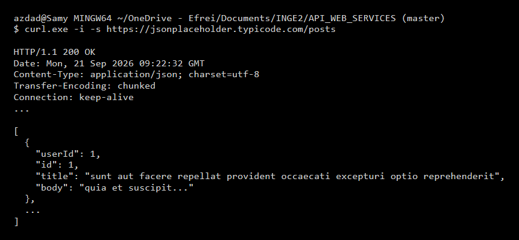

- Code de statut : 200 OK (requête réussie).
- Nombre d'éléments : 100 posts.
- Structure : C'est une liste d'objets JSON avec les clés userId, id, title et body.

Paramètres de requête :
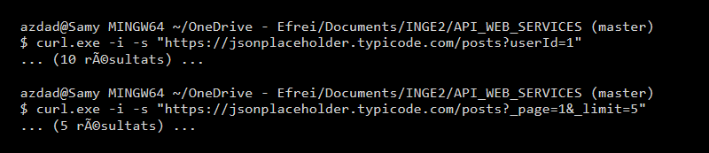

- Résultats : 10 posts avec userId=1, et 5 posts avec _limit=5.
- Intérêt : Ça permet de filtrer ou paginer sans devoir créer une route serveur pour chaque cas.

## Tâche 2 - En-têtes HTTP

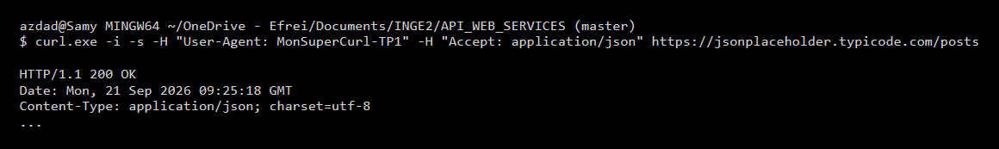

- L'en-tête de requête est envoyé par le client pour dire ce qu'il veut, l'en-tête de réponse est renvoyé par le serveur pour décrire ce qu'il donne.
- Accept = ce que le client veut recevoir. Content-Type = le format réel envoyé.

## Tâche 3 - POST, PUT, PATCH, DELETE

Créer (POST) :
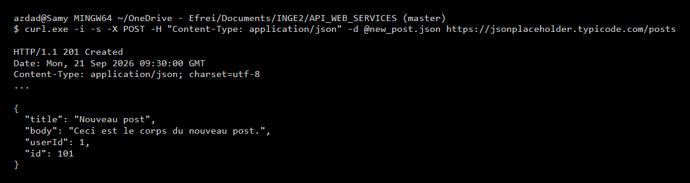

Remplacer (PUT) :
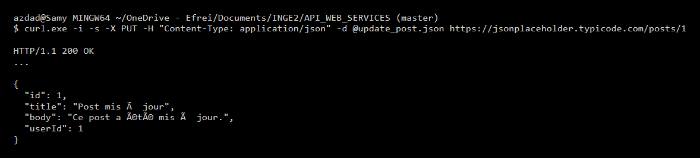

Modifier (PATCH) :
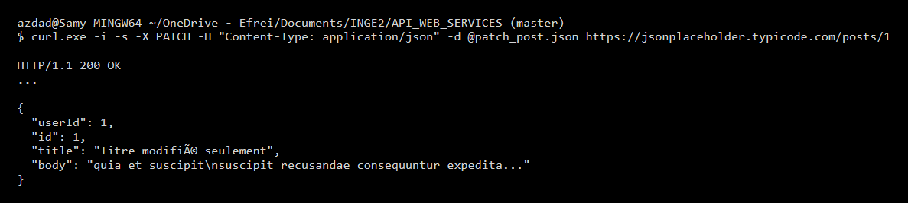

- PUT remplace toute la ressource, PATCH modifie juste les champs donnés (ici le titre est modifié et le reste est gardé).

Supprimer (DELETE) :
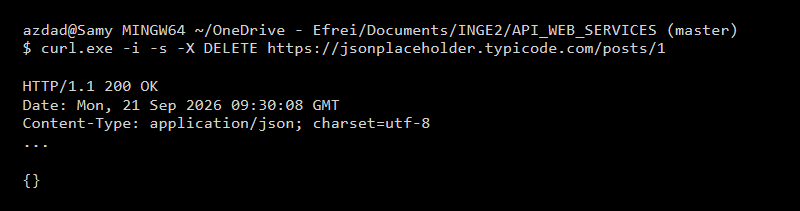

- La réponse 204 No Content a un corps vide. C'est normal car la ressource est supprimée, le serveur n'a plus rien à renvoyer à part confirmer le succès.

## Tâche 4 - Erreurs

404 Not Found :
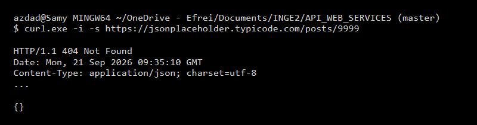

405 Method Not Allowed :
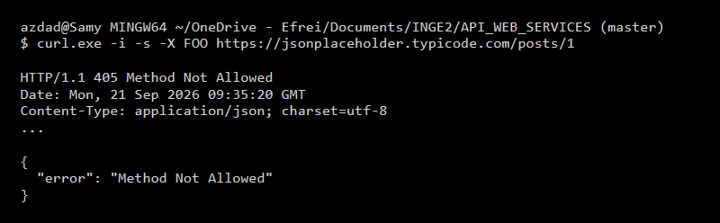

400 Bad Request :
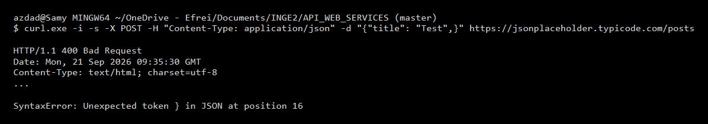

- Dans ces 3 cas (classe 4xx), l'erreur vient du client car il s'est trompé dans l'URL, la méthode ou le JSON envoyé. Les erreurs du serveur sont en 5xx.

## Tâche 5 - Tests

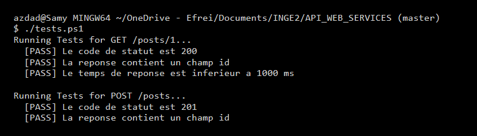

- C'est plus fiable qu'à l'oeil nu car ça évite les erreurs d'inattention et c'est automatique.
- C'est indispensable en intégration continue (CI/CD) pour vérifier qu'on ne casse rien avant une mise en prod.

## Tâche 6 - Jeton

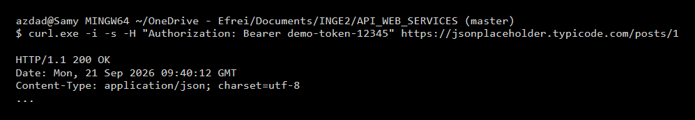

- Syntaxe : Authorization: Bearer <jeton>
- Le HTTPS est obligatoire pour chiffrer le token, sinon il passe en clair sur le réseau et peut être volé.

## Tâche 7 - Documentation

- La doc Postman sert de contrat d'API : elle liste les routes et les formats attendus pour que le client puisse l'utiliser sans regarder le code serveur.

## Récapitulatif et Réflexion

| Méthode | URL | Statut | Résultat |
|---|---|---|---|
| GET | /posts | 200 OK | Liste des posts récupérée |
| POST | /posts | 201 Created | Post créé |
| PUT | /posts/1 | 200 OK | Post remplacé |
| PATCH | /posts/1 | 200 OK | Titre modifié |
| DELETE| /posts/1 | 200 OK | Post supprimé |

Le protocole HTTP permet de faire des API propres et uniformes grâce à ses méthodes (GET, POST...) et ses codes de retour clairs (200, 404...). Ça rend le système logique.
L'ajout de tests automatisés (Tâche 5) permet de sécuriser l'application. Sur un projet, on ne peut pas tester chaque route à la main à chaque changement. Les tests s'assurent que les modifications de code ne créent pas de bugs sur l'API existante.
