# TP 2 : API REST Avancées avec Spring Boot

**Étudiant :** AZDAD Samy — **Groupe :** BDML1

---

## Base de Données (Script SQL)

```sql
-- Table des utilisateurs (BCrypt)
CREATE TABLE users (
    id BIGINT AUTO_INCREMENT PRIMARY KEY,
    username VARCHAR(255) NOT NULL UNIQUE,
    password VARCHAR(255) NOT NULL,
    email VARCHAR(255) NOT NULL,
    role VARCHAR(50) NOT NULL
);

-- Table des Refresh Tokens (JWT)
CREATE TABLE refresh_tokens (
    id BIGINT AUTO_INCREMENT PRIMARY KEY,
    user_id BIGINT NOT NULL UNIQUE,
    token VARCHAR(255) NOT NULL UNIQUE,
    expiry_date TIMESTAMP NOT NULL,
    CONSTRAINT fk_refresh_user FOREIGN KEY (user_id) REFERENCES users(id) ON DELETE CASCADE
);

-- Table des relevés IMC (BMI)
CREATE TABLE bmi_records (
    id BIGINT AUTO_INCREMENT PRIMARY KEY,
    user_id BIGINT NOT NULL,
    weight DOUBLE NOT NULL,
    height DOUBLE NOT NULL,
    bmi DOUBLE NOT NULL,
    category VARCHAR(50),
    interpretation VARCHAR(255),
    created_at TIMESTAMP NOT NULL,
    CONSTRAINT fk_bmi_user FOREIGN KEY (user_id) REFERENCES users(id) ON DELETE CASCADE
);

-- Table des opérations de la calculatrice
CREATE TABLE operations (
    id BIGINT AUTO_INCREMENT PRIMARY KEY,
    operateur VARCHAR(50) NOT NULL,
    a DOUBLE NOT NULL,
    b DOUBLE NOT NULL,
    resultat DOUBLE NOT NULL,
    date TIMESTAMP NOT NULL
);

-- Table des transactions de conversion de devises
CREATE TABLE currency_transactions (
    id BIGINT AUTO_INCREMENT PRIMARY KEY,
    from_currency VARCHAR(3) NOT NULL,
    to_currency VARCHAR(3) NOT NULL,
    amount DOUBLE NOT NULL,
    converted_amount DOUBLE NOT NULL,
    rate DOUBLE NOT NULL,
    rate_source VARCHAR(50),
    timestamp TIMESTAMP NOT NULL
);

-- Table des taux de change locaux personnalisés
CREATE TABLE custom_exchange_rates (
    id BIGINT AUTO_INCREMENT PRIMARY KEY,
    from_currency VARCHAR(3) NOT NULL,
    to_currency VARCHAR(3) NOT NULL,
    rate DOUBLE NOT NULL,
    updated_at TIMESTAMP NOT NULL
);
```

---

## Exercice 1 — Calculatrice REST

### Endpoints
- `POST /api/calculator` : effectue l'opération demandée (`ADDITION`, `SOUSTRACTION`, `MULTIPLICATION`, `DIVISION`).
- `GET /api/calculator/history?page=0&size=10&sort=date,desc` : historique avec pagination Spring Data (`Pageable`).
- `GET /api/calculator/{id}` : récupération d'un calcul.
- `PUT /api/calculator/{id}` : mise à jour d'un calcul.
- `DELETE /api/calculator/{id}` : suppression d'un calcul.

### Gestion d'erreurs (400 Bad Request)
Géré par `GlobalExceptionHandler` avec le format JSON requis en cas de division par zéro ou d'entrées invalides.

### Captures Postman

**Calcul réussi (201 Created) :**
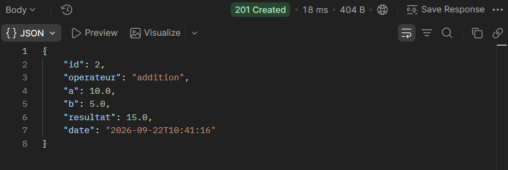

**Division par zéro (400 Bad Request) :**
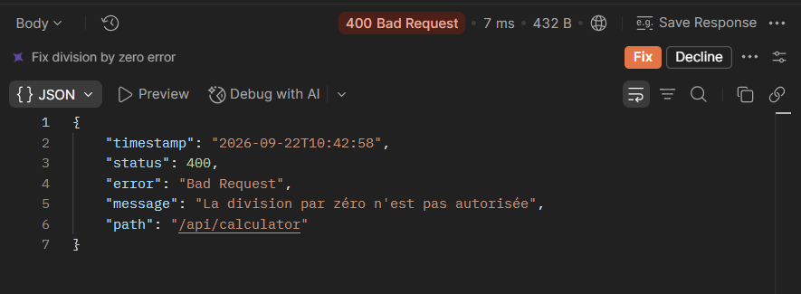

**Historique paginé (200 OK) :**
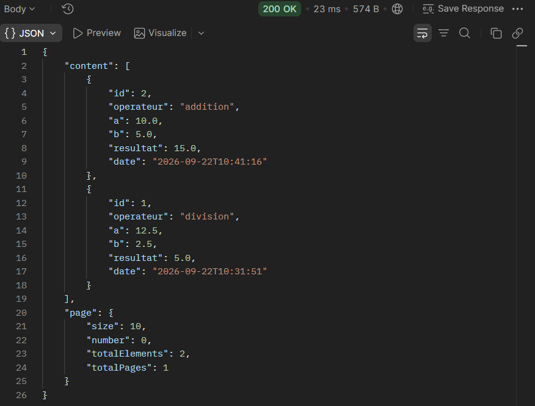

---

## Exercice 2 — Devises avec Taux Dynamiques

### Endpoints
- `GET /api/currency/convert?amount=...&from=...&to=...` : conversion via l'API externe (Frankfurter) avec `WebClient`, mis en cache (`@Cacheable`).
- `POST /api/currency/convert` : conversion manuelle avec taux personnalisé.
- `PUT /api/currency/update-rate` : mise à jour d'un taux localement.
- `DELETE /api/currency/delete-transaction/{id}` : suppression d'une transaction.

### Robustesse & Rate Limiting
- **Transactions** : `@Transactional` pour garantir la persistance uniquement si le calcul réussit.
- **Résilience** : Retries avec backoff sur l'API externe, renvoi d'une `503 Service Unavailable` en cas d'échec.
- **Limitation de débit (Bucket4j)** : 20 requêtes/min par IP sur `GET /api/currency/convert`, renvoie **429 Too Many Requests** au-delà.

### Captures Postman

**Conversion avec API externe (200 OK) :**
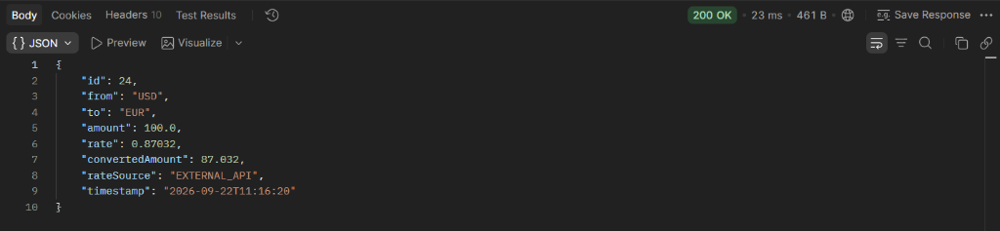

**Conversion manuelle (201 Created) :**
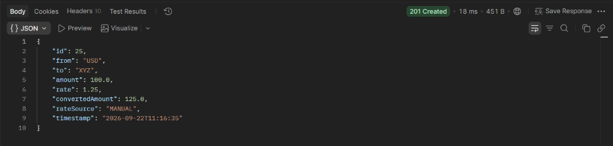

**Mise à jour taux local (200 OK) :**
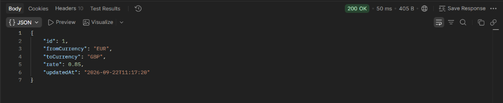

**Conversion avec taux local prioritaire (200 OK) :**
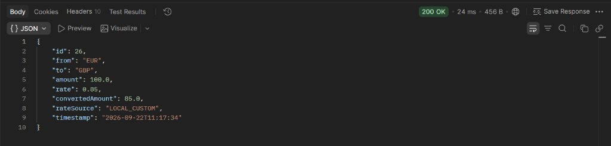

**Rate Limiting dépassé (429 Too Many Requests via Collection Runner) :**
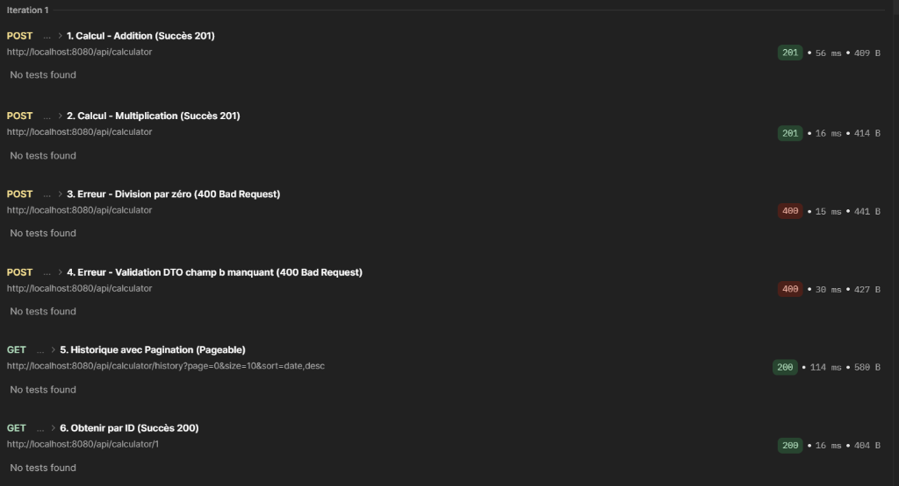

---

## Exercice 3 — BMI & Authentification JWT

### Endpoints
- `POST /api/auth/register` : inscription d'un utilisateur (mot de passe haché en BCrypt).
- `POST /api/auth/login` : authentification, renvoie un Access Token (15 min) et un Refresh Token (7 jours).
- `POST /api/auth/refresh` : renouvellement du token d'accès via Refresh Token.
- `POST /api/bmi/calculate` : calcul et enregistrement de l'IMC de l'utilisateur connecté (JWT requis).
- `GET /api/bmi/history` : historique de l'utilisateur connecté.
- `PUT /api/bmi/update/{id}` : mise à jour (autorisé uniquement pour le propriétaire).
- `DELETE /api/bmi/delete/{id}` : suppression (autorisé uniquement pour le propriétaire).
- `GET /api/bmi/statistics` : statistiques globales anonymisées (moyenne, min, max, répartition par catégorie).

### Sécurité
- Requête sans token -> **401 Unauthorized**.
- Tentative de suppression/modification d'un enregistrement appartenant à un autre utilisateur -> **403 Forbidden**.

### Captures Postman

**Accès refusé sans token JWT (401 Unauthorized) :**
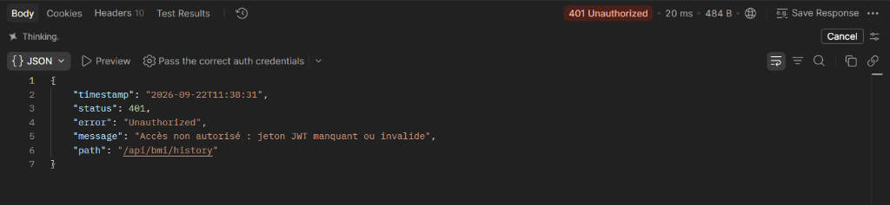

**Calcul IMC avec token (201 Created) :**
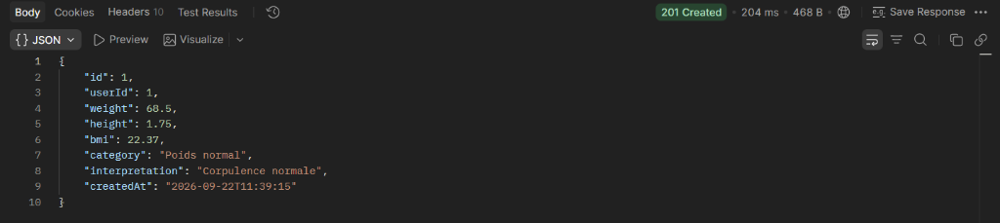

**Tentative de suppression par un autre utilisateur (403 Forbidden) :**
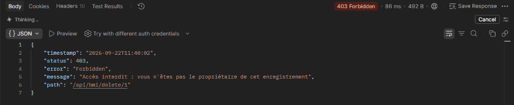

**Statistiques globales anonymisées (200 OK) :**
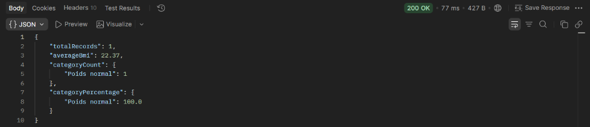

---

## Tests Automatisés (JUnit 5 / MockMvc)

16 tests exécutés et validés avec `mvn test` :
- `CalculatorControllerTest` : 6 tests (calculs valides, division par zéro, pagination, validation)
- `CurrencyConverterControllerTest` : 4 tests (conversion externe, taux manuel, mise à jour, rollback)
- `BMICalculatorControllerTest` : 5 tests (401 sans token, 201 calcul, 403 non-propriétaire, stats)
- `Tp2ApplicationTests` : 1 test (chargement du contexte)

**Résultat : 16/16 passés (0 erreur, 0 échec).**
