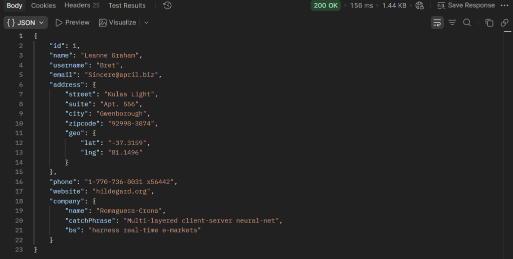
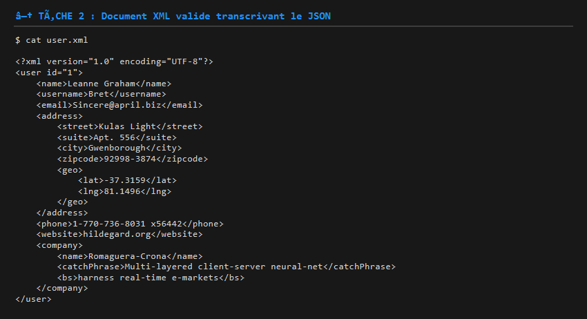
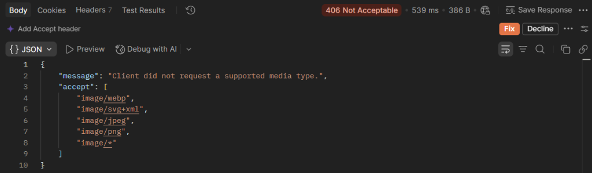
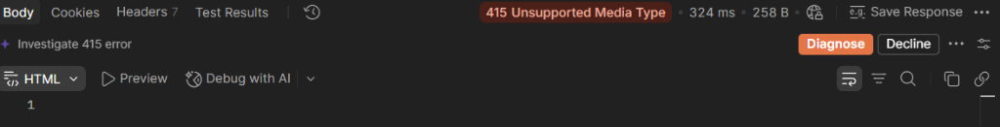
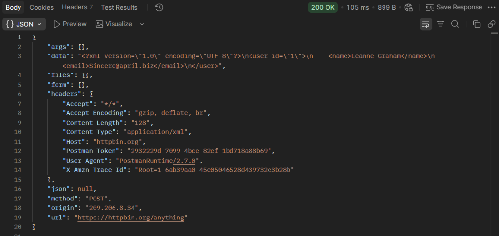
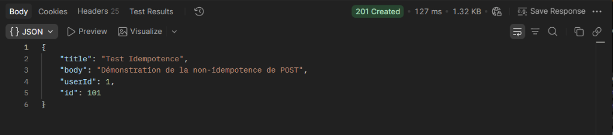
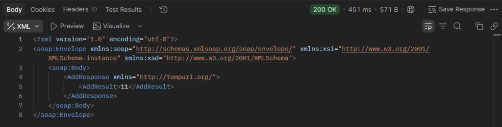
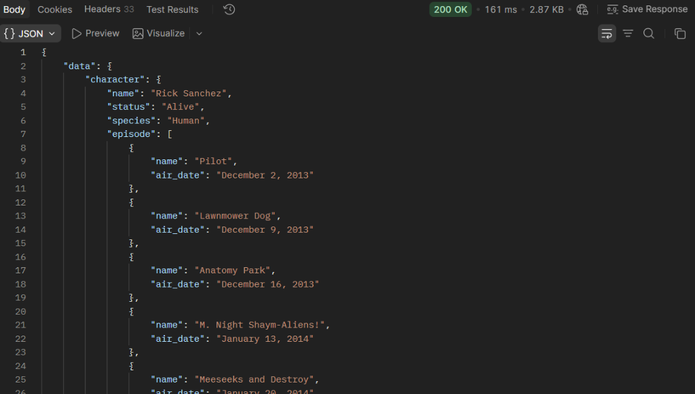
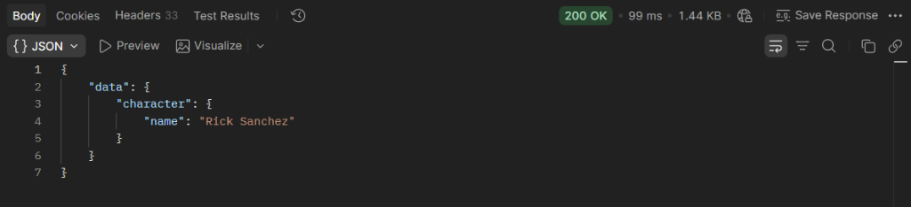

# Rapport TP 3

**Auteurs :** AZDAD Samy, BENHADDYA Loqmann  
**Date :** Année Universitaire 2026-2027  

---

## Sommaire

1. [Partie 1 — Formats de Données (Chapitre 3)](#partie-1--formats-de-données-chapitre-3)
   - [Tâche 1 — Identifier les types JSON dans une réponse réelle](#tâche-1--identifier-les-types-json-dans-une-réponse-réelle)
   - [Tâche 2 — Convertir du JSON en XML](#tâche-2--convertir-du-json-en-xml)
   - [Tâche 3 — Négociation de contenu et codes d'erreur](#tâche-3--négociation-de-contenu-et-codes-derreur)
2. [Partie 2 — REST et SOAP (Chapitre 4)](#partie-2--rest-et-soap-chapitre-4)
   - [Tâche 4 — Concevoir des URLs RESTful](#tâche-4--concevoir-des-urls-restful)
   - [Tâche 5 — Tester la non-idempotence de POST](#tâche-5--tester-la-non-idempotence-de-post)
   - [Tâche 6 — Interroger un vrai service SOAP](#tâche-6--interroger-un-vrai-service-soap)
3. [Partie 3 — GraphQL et gRPC (Chapitre 5)](#partie-3--graphql-et-grpc-chapitre-5)
   - [Tâche 7 — Écrire une requête GraphQL contre une vraie API](#tâche-7--écrire-une-requête-graphql-contre-une-vraie-api)
   - [Tâche 8 — Modifier la requête pour observer l'over-fetching](#tâche-8--modifier-la-requête-pour-observer-lover-fetching)
   - [Tâche 9 — Concevoir un schéma GraphQL](#tâche-9--concevoir-un-schéma-graphql)
   - [Tâche 10 — Concevoir un service gRPC](#tâche-10--concevoir-un-service-grpc)
4. [Synthèse Comparative Globale](#synthèse-comparative-globale)

---

# Partie 1 — Formats de Données (Chapitre 3)

## Tâche 1 — Identifier les types JSON dans une réponse réelle

### Protocole expérimental
Une requête HTTP `GET` est envoyée vers l'endpoint public de test :  
`GET https://jsonplaceholder.typicode.com/users/1`

### Capture d'écran de la requête et de la réponse


### Corps de la réponse obtenue (JSON)
```json
{
  "id": 1,
  "name": "Leanne Graham",
  "username": "Bret",
  "email": "Sincere@april.biz",
  "address": {
    "street": "Kulas Light",
    "suite": "Apt. 556",
    "city": "Gwenborough",
    "zipcode": "92998-3874",
    "geo": {
      "lat": "-37.3159",
      "lng": "81.1496"
    }
  },
  "phone": "1-770-736-8031 x56442",
  "website": "hildegard.org",
  "company": {
    "name": "Romaguera-Crona",
    "catchPhrase": "Multi-layered client-server neural-net",
    "bs": "harness real-time e-markets"
  }
}
```

### Question à consigner : Identification des 6 types JSON
Le standard JSON (RFC 8259) définit 6 types de données primitifs et structurés. L'analyse de la réponse donne les résultats suivants :

| Type JSON | Présence dans la réponse | Exemple extrait du corps | Commentaire technique |
|---|:---:|---|---|
| **`string`** | **Présent** | `"name": "Leanne Graham"` ou `"email": "Sincere@april.biz"` | Chaîne de caractères UTF-8 délimitée par des guillemets doubles. |
| **`number`** | **Présent** | `"id": 1` | Nombre entier non entouré de guillemets. *(Remarque : bien que `lat` et `lng` soient des grandeurs numériques, ils sont encodés en `string` dans cette API)*. |
| **`boolean`** | **Absent** | *(Aucun champ)* | Les littéraux `true` ou `false` n'apparaissent pas dans ce profil utilisateur. |
| **`null`** | **Absent** | *(Aucun champ)* | Aucun champ n'a la valeur littérale `null`. |
| **`object`** | **Présent** | `"address": { ... }` ou `"geo": { ... }` | Ensemble de paires clé/valeur délimité par des accolades `{}` (l'objet racine en est également un). |
| **`array`** | **Absent** | *(Aucun champ)* | Aucun tableau indexé délimité par des crochets `[...]` n'est présent dans cette ressource unitaire. |

---

## Tâche 2 — Convertir du JSON en XML

### Document XML complet (`user.xml`)
La transcription respecte un nœud racine unique, l'imbrication correcte des sous-structures hiérarchiques (`address` et `geo`), et une sémantique rigoureuse entre éléments et attributs.

```xml
<?xml version="1.0" encoding="UTF-8"?>
<user id="1">
    <name>Leanne Graham</name>
    <username>Bret</username>
    <email>Sincere@april.biz</email>
    <address>
        <street>Kulas Light</street>
        <suite>Apt. 556</suite>
        <city>Gwenborough</city>
        <zipcode>92998-3874</zipcode>
        <geo>
            <lat>-37.3159</lat>
            <lng>81.1496</lng>
        </geo>
    </address>
    <phone>1-770-736-8031 x56442</phone>
    <website>hildegard.org</website>
    <company>
        <name>Romaguera-Crona</name>
        <catchPhrase>Multi-layered client-server neural-net</catchPhrase>
        <bs>harness real-time e-markets</bs>
    </company>
</user>
```

### Capture d'écran du document XML


### Question à consigner : Justification du choix pour le champ `id`
**Choix effectué :** Le champ `id` a été représenté comme un **attribut** de la balise racine : `<user id="1">`.

**Justification avec le critère vu en cours :**
Selon les règles de modélisation XML vues en cours :
1. **Les attributs** sont réservés aux **métadonnées techniques** et aux identifiants uniques qui qualifient une entité sans faire partie de son contenu textuel métier propre. Un attribut ne peut pas être décomposé, ne possède pas de sous-structure et est unique pour chaque élément.
2. **Les éléments enfants** sont privilégiés pour les **données métier** affichables (comme le `name`, l'`email`, ou l'`address`), qui sont susceptibles d'évoluer, de contenir des sous-éléments imbriqués ou d'être répétées.

L'identifiant `id="1"` étant un identifiant technique synthétique qualifiant l'élément `<user>`, sa modélisation en attribut respecte les standards canoniques du W3C.

---

## Tâche 3 — Négociation de contenu et codes d'erreur

### 1. Test du statut 406 (Not Acceptable)
- **Requête :** `GET https://httpbin.org/status/406`
- **Réponse :** `HTTP/1.1 406 NOT ACCEPTABLE`


### 2. Test du statut 415 (Unsupported Media Type)
- **Requête :** `GET https://httpbin.org/status/415`
- **Réponse :** `HTTP/1.1 415 UNSUPPORTED MEDIA TYPE`


### 3. Test de transmission de contenu XML (POST Anything)
- **Requête :** `POST https://httpbin.org/anything`  
  - En-tête : `Content-Type: application/xml`  
  - Corps : Charge utile XML de l'utilisateur
- **Observation :** Dans le corps JSON retourné par `httpbin.org`, la section `"headers"` contient explicitement `"Content-Type": "application/xml"`, confirmant la bonne réception de l'en-tête par le serveur.


### Question à consigner : Rôle des codes 406 et 415 dans une négociation de contenu
Dans le cadre d'un serveur implémentant une véritable négociation de contenu HTTP (Content Negotiation) :
- **Le code HTTP 406 (*Not Acceptable*)** est renvoyé par le serveur lorsque le format demandé par le client dans son en-tête `Accept` (ex. `Accept: application/xml`) n'est pas pris en charge par le serveur, qui ne peut produire aucune représentation correspondante.
- **Le code HTTP 415 (*Unsupported Media Type*)** est renvoyé par le serveur lorsqu'il refuse de traiter le corps de la requête parce que le format de données envoyé par le client, spécifié dans l'en-tête `Content-Type` (ex. `Content-Type: application/xml`), n'est pas supporté par l'endpoint cible.

---

# Partie 2 — REST et SOAP (Chapitre 4)

## Tâche 4 — Concevoir des URLs RESTful

### Scénario
Conception de l'API REST d'une bibliothèque en ligne modélisant trois ressources principales : les **livres** (`livres`), les **auteurs** (`auteurs`) et les **emprunts** (`emprunts`).

### Règles de conception appliquées
- Noms de ressources au pluriel et substantifs (pas de verbes dans les URLs).
- Utilisation de la méthode HTTP appropriée pour spécifier l'intention d'action.
- Utilisation des chaînes de requête (`query string`) pour le filtrage et la sélection.
- Relations hiérarchiques représentées par l'imbrication de sous-ressources.

### Tableau des 6 URLs RESTful conçues

| N° | Action métier | Méthode HTTP | URL RESTful | Corps de requête (Body) | Justification des principes REST |
|:---:|---|:---:|---|:---:|---|
| **1** | Lister tous les livres | `GET` | `/livres` | *Aucun* | Consultation de la collection complète des livres (ressource au pluriel). |
| **2** | Récupérer le livre d'identifiant 42 | `GET` | `/livres/42` | *Aucun* | Identification univoque d'un élément spécifique de la collection par son ID dans le chemin. |
| **3** | Lister uniquement les livres disponibles | `GET` | `/livres?disponible=true` | *Aucun* | Utilisation d'un paramètre de requête (`?disponible=true`) pour filtrer la ressource sans créer de faux chemin d'URI. |
| **4** | Emprunter le livre 42 (créer un emprunt) | `POST` | `/emprunts` *(ou `/livres/42/emprunts`)* | `{"livreId": 42, "date": "2026-09-23"}` | Création d'une nouvelle ressource d'emprunt via `POST` sur la collection des emprunts. |
| **5** | Récupérer tous les livres d'un auteur précis (ID 7) | `GET` | `/auteurs/7/livres` | *Aucun* | Modélisation d'une sous-ressource liée : collection des livres dépendant de l'auteur d'identifiant 7. |
| **6** | Mettre fin à l'emprunt d'identifiant 15 | `PATCH` *(ou `DELETE`)* | `/emprunts/15` | `{"statut": "termine", "dateRetour": "..."}` | Modification partielle de l'état de l'emprunt pour le clôturer (ou suppression logique avec `DELETE`). |

---

## Tâche 5 — Tester la non-idempotence de POST

### Protocole expérimental
Envoi consécutif de deux requêtes HTTP `POST` strictement identiques avec le même corps JSON vers :  
`POST https://jsonplaceholder.typicode.com/posts`  
Corps envoyé : `{"title": "Test Idempotence", "body": "Contenu du post", "userId": 1}`

### Capture d'écran des deux réponses obtenues


### Question à consigner : Analyse des réponses et démonstration de la non-idempotence
1. **Observation des réponses :**  
   Les deux réponses renvoient le code de statut HTTP `201 Created` avec un corps identique contenant `"id": 101`. Ce comportement est propre au faux serveur (mock) JSONPlaceholder, qui simule une création statique sans écriture en base de données.
2. **Démonstration théorique et concrète de la non-idempotence :**  
   Une méthode HTTP est dite **idempotente** si exécuter une requête $N$ fois a rigoureusement le même effet sur l'état du serveur qu'une seule exécution.
   - Sur un serveur de production réel, exécuter cette requête deux fois de suite insérerait **deux enregistrements distincts** en base de données (création d'un premier post avec `id=101`, puis d'un deuxième post avec `id=102`).
   - L'état du système après le second appel n'est donc pas identique à l'état après le premier appel.
   - Cela démontre concrètement que **la méthode POST n'est pas idempotente** (contrairement à `GET`, `PUT` ou `DELETE`). C'est précisément pour cela que les navigateurs web affichent un avertissement (« Voulez-vous renvoyer les données ? ») en cas de rafraîchissement d'un formulaire soumis en `POST`.

---

## Tâche 6 — Interroger un vrai service SOAP

### Protocole expérimental
- **Méthode :** `POST`
- **URL :** `http://www.dneonline.com/calculator.asmx`
- **En-têtes HTTP :**  
  - `Content-Type: text/xml; charset=utf-8`  
  - `SOAPAction: "http://tempuri.org/Add"`
- **Corps XML envoyé :**
```xml
<?xml version="1.0" encoding="utf-8"?>
<soap:Envelope xmlns:xsi="http://www.w3.org/2001/XMLSchema-instance"
               xmlns:xsd="http://www.w3.org/2001/XMLSchema"
               xmlns:soap="http://schemas.xmlsoap.org/soap/envelope/">
  <soap:Body>
    <Add xmlns="http://tempuri.org/">
      <intA>4</intA>
      <intB>7</intB>
    </Add>
  </soap:Body>
</soap:Envelope>
```

### Capture d'écran de la requête et de la réponse


### Réponse SOAP obtenue
```xml
<?xml version="1.0" encoding="utf-8"?>
<soap:Envelope xmlns:soap="http://schemas.xmlsoap.org/soap/envelope/"
               xmlns:xsi="http://www.w3.org/2001/XMLSchema-instance"
               xmlns:xsd="http://www.w3.org/2001/XMLSchema">
  <soap:Body>
    <AddResponse xmlns="http://tempuri.org/">
      <AddResult>11</AddResult>
    </AddResponse>
  </soap:Body>
</soap:Envelope>
```

### Questions à consigner

#### 1. Identification de l'Envelope et du Body dans la réponse
- **`<soap:Envelope>` :** Il s'agit du conteneur racine obligatoire de tout message SOAP. Il définit le protocole de messagerie SOAP et les espaces de noms XML requis (`xmlns:soap`).
- **`<soap:Body>` :** Il s'agit du sous-élément direct de l'enveloppe contenant la charge utile métier applicative (`<AddResponse>` et son résultat `<AddResult>11</AddResult>`).

#### 2. Utilisation des verbes HTTP et comparaison avec REST (Tâche 4)
- **Constat :** En SOAP, **toutes les opérations** (`Add`, `Subtract`, `Multiply`, `Divide`) utilisent systématiquement et uniquement le verbe HTTP `POST`.
- **Comparaison avec REST :** En REST, le verbe HTTP exprime la sémantique de l'action (`GET` pour lire, `POST` pour créer, `PUT`/`PATCH` pour modifier, `DELETE` pour supprimer). En SOAP, HTTP n'est utilisé que comme un **simple protocole de transport aveugle (tunneling RPC)**, ignorant totalement la sémantique native du protocole HTTP.

#### 3. Localisation du nom de l'opération et différence structurelle REST vs SOAP
- **Localisation :** Le nom de l'opération (`Add`) n'apparaît **absolument pas dans l'URL** (qui demeure statiquement `http://www.dneonline.com/calculator.asmx`). Il est encapsulé au cœur du corps XML (`<Add xmlns="...">`) et parfois dupliqué dans l'en-tête HTTP `SOAPAction`.
- **Différence structurelle fondamentale :**
  - **REST est orienté ressources :** Les URLs désignent des entités ou collections identifiables (`/livres/42`), et le standard HTTP dicte les actions applicables.
  - **SOAP est orienté opérations / RPC (*Remote Procedure Call*) :** Il existe un endpoint unique (le service) auprès duquel le client invoque des méthodes distantes en empaquetant le nom de la fonction et ses paramètres dans une enveloppe XML opaque.

---

# Partie 3 — GraphQL et gRPC (Chapitre 5)

## Tâche 7 — Écrire une requête GraphQL contre une vraie API

### Requête exécutée
Interface interactive : `https://rickandmortyapi.com/graphql`

```graphql
query {
  character(id: 1) {
    name
    status
    species
    episode {
      name
      air_date
    }
  }
}
```

### Capture d'écran de l'exécution


### Observation de la réponse
La réponse retourne le personnage Rick Sanchez et l'arborescence complète de ses **51 épisodes** associés (avec nom et date de diffusion pour chacun) au sein d'une seule charge JSON de **3 537 octets**.

### Question à consigner : Comparaison avec une API REST classique et notion d'under-fetching
1. **Nombre d'appels requis en REST classique :**
   - Avec une API REST traditionnelle (telle que celle de Rick & Morty REST `https://rickandmortyapi.com/api/character/1`), l'appel initial `GET /character/1` renvoie les informations du personnage avec une simple liste d'URLs d'épisodes : `["https://.../episode/1", "https://.../episode/2", ...]`.
   - Pour obtenir le nom et la date de diffusion de chacun de ces 51 épisodes, l'application cliente devrait effectuer **51 requêtes HTTP supplémentaires** (`GET /episode/1`, `GET /episode/2`, etc.).
   - Le client devrait donc exécuter un total de **52 requêtes réseau distinctes** (1 pour le personnage + 51 pour les épisodes), ce qui illustre le problème classique du **$N+1$ requêtes**.
2. **Lien avec la notion d'under-fetching :**
   - L'**under-fetching** survient lorsqu'un endpoint REST ne fournit pas suffisamment de données dans une seule réponse pour satisfaire les besoins de l'écran ou du composant client.
   - Cela impose une multiplication coûteuse des allers-retours réseau (round-trips), augmentant la latence globale et dégradant l'expérience utilisateur (notamment sur réseau mobile).
   - **GraphQL résout totalement l'under-fetching** en permettant au client de déclarer en une seule requête imbriquée l'ensemble du graphe relationnel dont il a besoin.

---

## Tâche 8 — Modifier la requête pour observer l'over-fetching

### Requête allégée exécutée
```graphql
query {
  character(id: 1) {
    name
  }
}
```

### Capture d'écran de l'exécution


### Réponse obtenue
```json
{
  "data": {
    "character": {
      "name": "Rick Sanchez"
    }
  }
}
```

### Question à consigner : Comparaison des tailles et évitement de l'over-fetching
1. **Comparaison métrique de la taille des réponses :**
   - Réponse Tâche 7 (requête détaillée) : **3 537 octets**.
   - Réponse Tâche 8 (nom uniquement) : **49 octets**.
   - Réduction de charge réseau : **98,6 % d'octets économisés** sur ce simple appel !
2. **Illustration concrète de l'évitement de l'over-fetching :**
   - En REST classique, interroger `GET /character/1` retourne obligatoirement la totalité des 16 champs définis par le serveur (id, status, species, type, gender, origin, location, image, episode, url, created...) même si l'application n'a besoin que du nom. Cette surcharge de données superflues constitue l'**over-fetching**.
   - En GraphQL, le client est maître du contrat de retour : le serveur ne calcule, ne sérialise et ne transmet que le champ strictement stipulé (`name`). GraphQL élimine ainsi le gaspillage de bande passante et optimise les performances client.

---

## Tâche 9 — Concevoir un schéma GraphQL (exercice écrit)

### Scénario
Gestion de la bibliothèque en ligne (Tâche 4) : modélisation d'un schéma permettant de récupérer un livre avec son auteur et la liste de ses emprunts en cours.

### Fichier de schéma complet (`schema.graphql`)
```graphql
"""
Représente un livre au sein du catalogue de la bibliothèque.
"""
type Livre {
  id: ID!
  titre: String!
  isbn: String!
  disponible: Boolean!
  nbPages: Int
  auteur: Auteur!
  emprunts(enCoursSeulement: Boolean = true): [Emprunt!]!
}

"""
Représente un auteur de la bibliothèque.
"""
type Auteur {
  id: ID!
  nom: String!
  biographie: String
  nationalite: String
  livres: [Livre!]!
}

"""
Représente un emprunt d'un livre par un adhérent.
"""
type Emprunt {
  id: ID!
  dateEmprunt: String!
  dateRetourPrevue: String!
  dateRetourEffective: String
  enCours: Boolean!
  livre: Livre!
  utilisateur: Utilisateur!
}

"""
Représente un utilisateur adhérent de la bibliothèque.
"""
type Utilisateur {
  id: ID!
  nom: String!
  email: String!
}

"""
Point d'entrée racine pour les opérations de lecture.
"""
type Query {
  livre(id: ID!): Livre
  livres(disponible: Boolean): [Livre!]!
  auteur(id: ID!): Auteur
}
```

### Exemple de requête cliente associée
```graphql
query ObtenirLivreComplet {
  livre(id: "42") {
    id
    titre
    disponible
    auteur {
      id
      nom
    }
    emprunts(enCoursSeulement: true) {
      id
      dateEmprunt
      dateRetourPrevue
      enCours
      utilisateur {
        nom
        email
      }
    }
  }
}
```

### Justification des choix de conception
- **Typage fort et non-nullité (`!`) :** L'usage du point d'exclamation garantit que les champs requis (comme l'`id` ou le `titre`) ne seront jamais `null`.
- **Paramètre de filtrage sur la relation (`enCoursSeulement`) :** L'argument permet de cibler directement les emprunts actifs sans surcharger le client avec l'historique complet des emprunts passés.
- **Relations bidirectionnelles :** La navigation naturelle du graphe permet d'interroger un livre et ses emprunts, ou un auteur et tous ses livres.

---

## Tâche 10 — Concevoir un service gRPC (exercice écrit)

### 1. Fichier de définition Protocol Buffers (`bibliotheque.proto`)
```protobuf
syntax = "proto3";

package bibliotheque;

option java_multiple_files = true;
option java_package = "com.efrei.bibliotheque.grpc";

// Message de requête contenant l'identifiant du livre recherché
message LivreRequest {
  int32 id = 1;
}

// Message de réponse contenant les informations du livre
message LivreResponse {
  int32 id = 1;
  string titre = 2;
  string auteur = 3;
  bool disponible = 4;
}

// Message d'abonnement au flux des nouveaux emprunts
message StreamEmpruntsRequest {
  string categorie_filtre = 1;
}

// Événement d'emprunt diffusé en temps réel
message EmpruntNotification {
  int32 emprunt_id = 1;
  int32 livre_id = 2;
  string titre_livre = 3;
  string utilisateur_nom = 4;
  string timestamp = 5;
}

// Service gRPC d'exposition des livres
service LivreService {
  // Méthode Unaire pour la récupération ponctuelle d'un livre
  rpc GetLivre (LivreRequest) returns (LivreResponse);

  // Méthode Server Streaming pour la notification continue des emprunts
  rpc SuivreEmpruntsEnTempsReel (StreamEmpruntsRequest) returns (stream EmpruntNotification);
}
```

### 2. Choix du mode de streaming pour `GetLivre`
- **Mode choisi :** **Mode Unaire (Unary RPC)**.
- **Justification :**  
  La méthode `GetLivre` répond à un besoin transactionnel simple de lecture unitaire par identifiant. Le client formule **une seule requête** (`LivreRequest`) et le serveur lui retourne **une seule réponse** (`LivreResponse`). Il n'y a ni volume continu de données à fractionner, ni latence à amortir par un flux asynchrone. L'appel unaire est le mode le plus direct, le plus rapide et le plus adapté pour une consultation synchrone de type clé-valeur.

### 3. Choix du mode pour le tableau de bord notifié en continu
- **Mode choisi :** **Server Streaming (Streaming Serveur)** via le mot-clé `stream` sur la réponse :  
  `rpc SuivreEmpruntsEnTempsReel (StreamEmpruntsRequest) returns (stream EmpruntNotification);`
- **Justification :**  
  Le besoin consiste à pousser au fil de l'eau (*push* en temps réel) chaque nouvel événement d'emprunt vers le tableau de bord dès qu'il se produit. Dans ce modèle :
  1. Le client (tableau de bord) envoie une unique requête initiale d'abonnement.
  2. Le serveur maintient la connexion HTTP/2 ouverte et diffuse un flux continu de messages (`stream`) au fur et à mesure des événements.
- **Comparaison avec la réponse précédente (`GetLivre`) :**  
  Alors que le mode Unaire de `GetLivre` ferme immédiatement la connexion après la remise de l'unique message de résultat (cycle requête/réponse fermé classique), le Server Streaming exploite les flux multiplexés de HTTP/2 pour établir une connexion persistante et asynchrone, évitant ainsi tout mécanisme de scrutation répétitive (*polling*) inefficace et coûteux en ressources.

---

# Synthèse Comparative Globale

Ce TP a permis d'explorer de manière concrète et comparative les grands paradigmes de communication inter-applications du marché :

| Critère | SOAP | REST | GraphQL | gRPC |
|---|---|---|---|---|
| **Protocole de transport** | HTTP (comme simple tunnel aveugle) | HTTP/1.1 ou HTTP/2 | HTTP (POST majoritaire) | HTTP/2 (obligatoire, binaire) |
| **Format des messages** | XML (Enveloppe rigide) | JSON (ou XML, texte...) | JSON (structuré selon requête) | Protocol Buffers (Binaire sérialisé) |
| **Philosophie d'exposition** | RPC (Appel de procédures distantes) | Orienté Ressources (CRUD sur URIs) | Orienté Graphe (Contrat flexible client) | RPC Haute performance typé |
| **Gestion du sous-fetching** | Dépend de la méthode RPC | Problématique ($N+1$ requêtes) | **Résolu** (Requêtes imbriquées) | Géré par messages composés ou streaming |
| **Gestion du sur-fetching** | Schéma figé | Problématique (Payloads complets) | **Résolu** (Sélection exacte des champs) | Modèle figé par `.proto`, mais binaire compact |
| **Streaming & Temps réel** | Non adapté | Nécessite WebSockets ou SSE | Subscriptions (WebSocket) | **Natif** (Unaire, Server, Client, Bidirectionnel) |
| **Cas d'usage privilégiés** | Systèmes bancaires / industriels hérités | APIs Web publiques et microservices légers | Front-ends web et mobiles riches | Communications microservices internes haute vitesse |

---
*Rapport réalisé et compilé pour le Master Ingénierie Informatique — EFREI Paris.*
