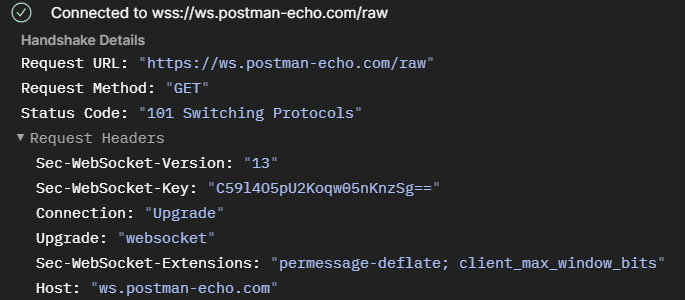
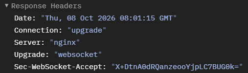
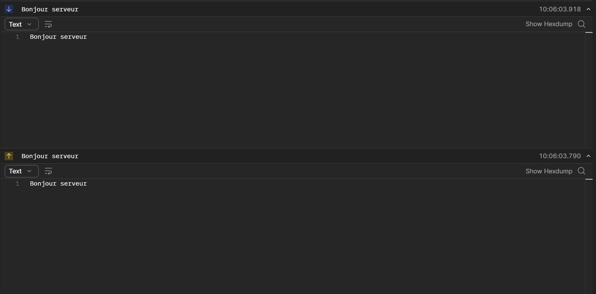
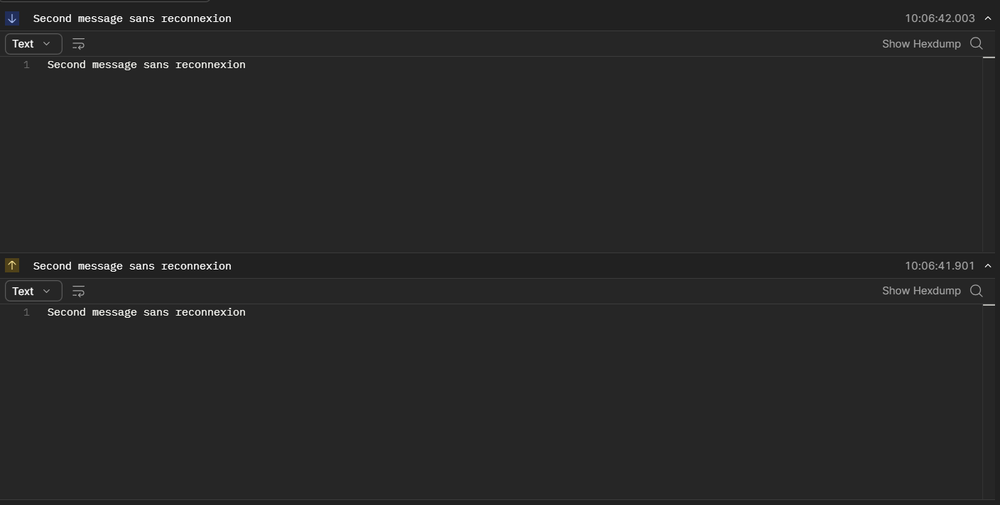
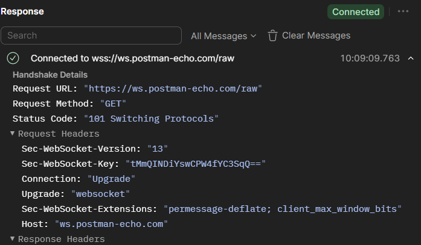
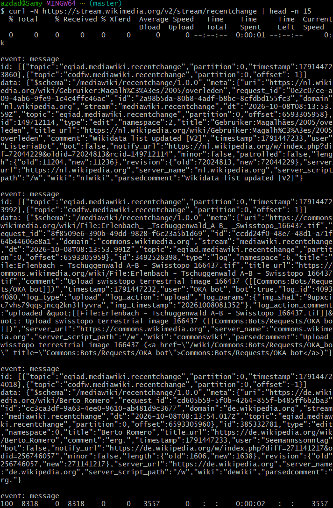
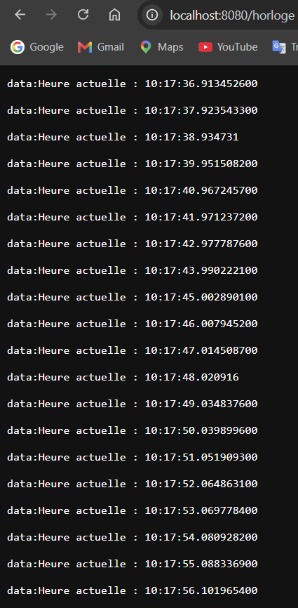
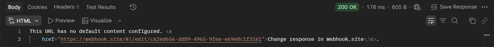
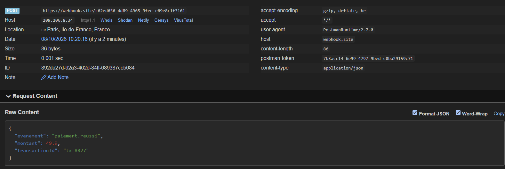

# Rapport TP 4 — API Temps Réel et Événementielles

**Auteurs :** AZDAD Samy, BENHADDYA Loqmann

---

# Partie 1 — WebSockets

## Tâches 1 et 2 — Connexion et échange de messages

**Tâche 1 — Code de statut**  
Le code affiché est **101 Switching Protocols**. Le client envoie un `GET` HTTP avec `Upgrade: websocket` et `Connection: Upgrade`, et le serveur accepte la bascule en répondant 101 (avec `Sec-WebSocket-Accept`). La connexion ne parle alors plus HTTP mais WebSocket.

**Tâche 2 — Connexion persistante**  
Non, il n'a fallu ni rouvrir de connexion, ni renvoyer l'URL ou une authentification : le handshake n'a eu lieu qu'une fois. La connexion reste ouverte et les messages circulent dans les deux sens sur le même canal. En REST, chaque échange est une nouvelle requête indépendante qui doit renvoyer URL, en-têtes et authentification, et seul le client peut lancer l'échange.

## Tâche 3 — Limites

L'historique est **perdu** : une connexion WebSocket ne stocke rien, chaque nouvelle connexion repart de zéro.

Dans le projet de messagerie, chaque message est enregistré en base de données côté serveur. À l'ouverture d'une conversation, l'historique est chargé par une requête REST (`GET /conversations/{id}/messages`), et le WebSocket ne sert qu'à recevoir les nouveaux messages en direct.

---

# Partie 2 — Server-Sent Events (SSE)

## Tâche 4 — Flux SSE Wikimedia

Chaque événement suit la structure vue en cours : une ligne `event: message`, une ligne `id: [...]`, une ligne `data:` contenant l'objet JSON, puis une ligne vide qui termine l'événement.

La connexion **ne s'est pas fermée** après le premier événement : les événements arrivent en continu sur la même requête, et c'est `head -n 15` qui a arrêté la commande.

## Tâche 5 — Endpoint SSE Spring Boot

Si le timeout était atteint, le serveur fermerait la connexion et l'heure s'arrêterait de défiler avant la fin des 20 événements. Avec SSE, un client `EventSource` se **reconnecte automatiquement** et renvoie l'en-tête `Last-Event-ID`, ce qui permet au serveur de reprendre le flux là où il s'était arrêté. Ici, notre code n'envoie pas d'`id` : il recommencerait donc le flux depuis le début.

---

# Partie 3 — Webhooks

## Tâches 6 et 7 — Webhook sur webhook.site

**Tâche 6**  
Oui, la requête apparaît instantanément sans rafraîchir la page. webhook.site garde une connexion **WebSocket** ouverte avec le navigateur et y pousse chaque nouvelle requête reçue.

**Tâche 7**

| Élément | Valeur observée |
|---|---|
| Méthode | `POST` |
| En-têtes | `content-type: application/json`, `content-length: 86`, `user-agent: PostmanRuntime/2.7.0`, `host: webhook.site`, `accept: */*` |
| Corps | `{ "evenement": "paiement.reussi", "montant": 49.90, "transactionId": "tx_8827" }` |

On retrouve une méthode, des en-têtes et un corps JSON, comme dans n'importe quelle requête HTTP : un Webhook est bien une requête HTTP ordinaire. Ce qui change, c'est seulement que c'est le serveur émetteur qui l'envoie quand l'événement se produit.

---

# Partie 4 — Conception pub/sub

## Tâche 8 — Architecture pub/sub

1. **Nom du topic :** `bibliotheque.livre.emprunte`
2. **Producteur et consommateurs :** Catalogue, Notifications et Statistiques sont tous les trois des **consommateurs** : ils réagissent à l'emprunt. Le **producteur** est le service qui enregistre l'emprunt (service Emprunts) et publie l'événement.
3. **Ajout du service de recommandation :** le producteur publie dans le topic sans savoir qui le lit. Il suffit d'abonner le nouveau service au topic existant (avec son propre groupe de consommateurs) : le service qui publie l'emprunt n'a pas à être modifié.
4. **Panne de Statistiques pendant 2 heures :** avec Kafka, les événements sont **conservés sur disque** pendant la durée de rétention, même s'ils n'ont pas été lus. Au redémarrage, Statistiques reprend à son dernier offset et traite les événements des deux heures manquées : rien n'est perdu. Avec un simple Webhook, les requêtes envoyées pendant la panne échouent et les événements sont perdus.
