# Rapport TP 5 — Sécurisation d'une API REST avec Spring Boot

**Auteurs :** AZDAD Samy, BENHADDYA Loqmann

---

# Exercice 1 — Authentification par clé API

**1. Pourquoi est-ce faiblement sécurisé ?**  
La clé est unique, statique et codée en dur : tous les clients la partagent, elle n'expire jamais et n'identifie personne. Si elle est interceptée (par exemple sans HTTPS), elle donne un accès total jusqu'à ce qu'on la change dans le code.

**2. Comment la renforcer ?**  
Imposer HTTPS, sortir la clé du code (variable d'environnement), donner une clé par client stockée hachée et révocable, avec une expiration et une rotation régulière.

---

# Exercice 2 — JWT et rôles

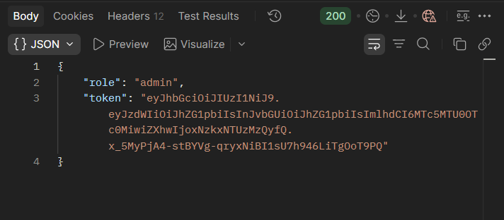

**1. Token signé ou chiffré ?**  
Un token **signé** (JWS, notre cas) est lisible par tous, mais sa signature empêche toute modification sans la clé : il garantit l'intégrité. Un token **chiffré** (JWE) est illisible sans la clé : il garantit aussi la confidentialité.

**2. Pourquoi pas de données sensibles dans un JWT ?**  
Son contenu est seulement encodé en Base64 : n'importe qui peut le décoder (le nôtre contient en clair le username et le rôle). Il circule aussi dans les en-têtes et les logs, et reste valable jusqu'à son expiration.

---

# Exercice 3 — XSS et injections

**1. Injection SQL ou injection XSS ?**  
L'injection SQL vise la base de données : l'entrée est exécutée comme du SQL (ex. `' OR 1=1 --`). On s'en protège avec des requêtes préparées. Le XSS vise les autres utilisateurs : un script stocké s'exécute dans leur navigateur. On s'en protège en échappant le HTML (`escapeHtml4`).

**2. Pourquoi la validation côté client ne suffit-elle pas ?**  
L'attaquant contrôle le client : il peut désactiver JavaScript ou appeler l'API directement avec Postman ou curl. Seule la validation côté serveur est fiable.

---

# Exercice 4 — Rate limiting

**1. Pourquoi cela améliore-t-il la disponibilité ?**  
Un client abusif (bot, force brute, déni de service) est bloqué par un `429` avant tout traitement coûteux. Il ne peut donc pas saturer le serveur au détriment des autres utilisateurs.

**2. Et avec plusieurs instances ?**  
Une `Map` locale compte séparément sur chaque instance. Il faut un compteur partagé, par exemple dans **Redis** (ou Bucket4j avec Redis), ou appliquer la limite dans une **API Gateway**.

---

# Exercice 5 — HTTPS et gestion des erreurs

**En quoi HTTPS protège-t-il la clé API et le JWT ?**  
TLS chiffre toute la requête, y compris l'en-tête `Authorization` : la clé et le token ne peuvent être ni lus ni rejoués par quelqu'un qui écoute le réseau. Le certificat authentifie le serveur, ce qui empêche une attaque de l'homme du milieu.

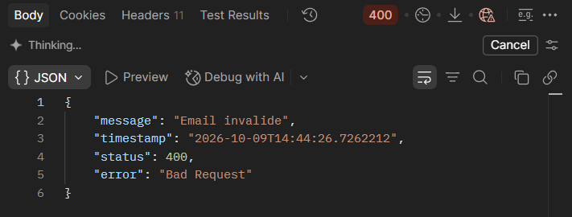

---

# Exercice 6 — Tests

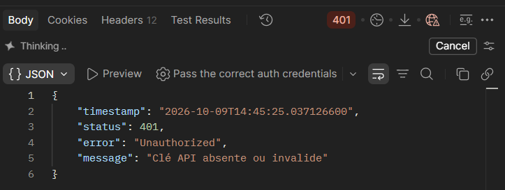
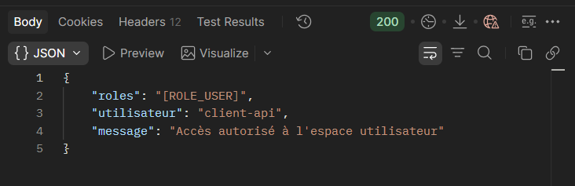
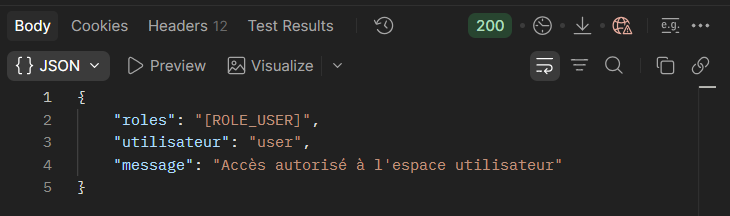
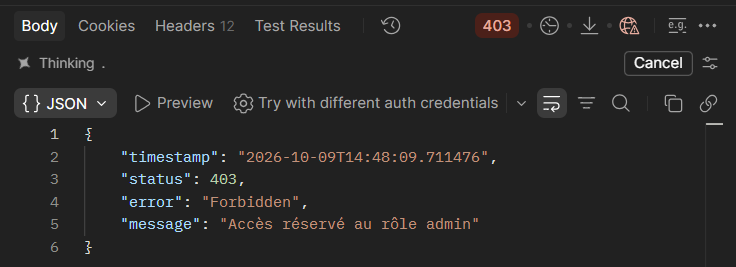
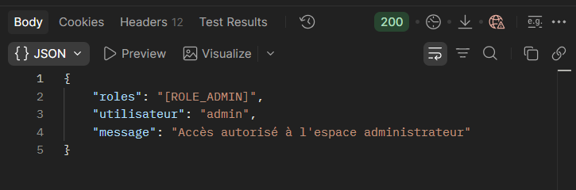
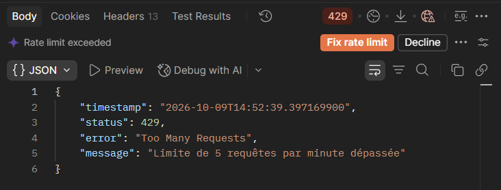
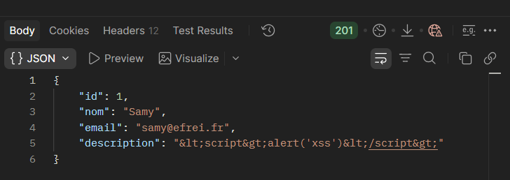
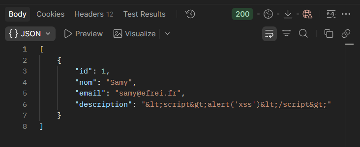
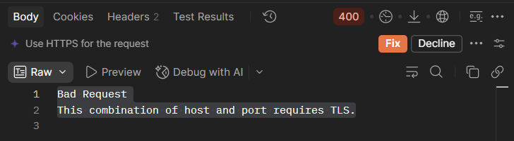

**1. Authentification ou autorisation ?**  
L'authentification vérifie **qui** est le client (en cas d'échec : `401`). L'autorisation vérifie **ce qu'il a le droit de faire** selon son rôle (en cas de refus : `403`).

**2. Rôle du chiffrement dans HTTPS**  
Le chiffrement asymétrique du handshake TLS authentifie le serveur et établit une clé de session. Le chiffrement symétrique (AES) protège ensuite la confidentialité et l'intégrité de tous les échanges.

**3. Réflexion finale : pourquoi combiner plusieurs mécanismes ?**  
Aucun mécanisme ne couvre à lui seul toutes les menaces : c'est le principe de défense en profondeur. L'authentification identifie le client mais ne dit rien de ses droits : c'est le rôle de l'autorisation. Un utilisateur authentifié et autorisé peut tout de même envoyer des données malveillantes : le filtrage et la validation des entrées bloquent alors les injections et le XSS. Un client légitime ou un bot peut aussi saturer l'API de requêtes, ce que seul le rate limiting empêche. Enfin, tous ces contrôles reposent sur des secrets (clé API, JWT) qui seraient interceptés et rejoués sans HTTPS. Chaque couche compense donc les faiblesses des autres : si l'une est contournée ou mal configurée, les suivantes limitent les dégâts. Dans notre API, une requête traverse successivement HTTPS, le rate limiting, la clé API ou le JWT, le contrôle des rôles, puis la validation des données : un attaquant doit les déjouer toutes pour réussir.
